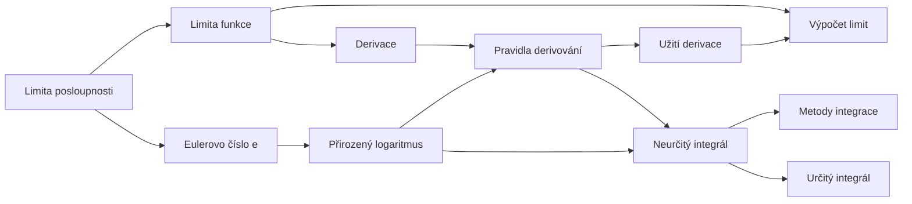

# Analýza

Matematická analýza studuje, jak se funkce **mění**. Tři hlavní nástroje: **limita** (k čemu se hodnoty blíží),
**derivace** (jak rychle se funkce mění) a **integrál** (kolik se „nasčítá" — plocha pod grafem).
{ .lead }

## Mapa pojmů

## Doporučené pořadí

**Základy**

1. [Druhy funkcí](druhy-funkci.md) — jak poznat konstantní, lineární, exponenciální…
2. [Eulerovo číslo $e$](eulerovo-cislo.md) — proč zrovna $2{,}718\ldots$
3. [Přirozený logaritmus](prirozeny-logaritmus.md) — $\ln x$, pravidla, rovnice

**Limity**

4. [Limita posloupnosti](limita-posloupnosti.md) — k čemu se blíží $a_n$
5. [Limita funkce](limita-funkce.md) — $\lim_{x \to a} f(x)$, jednostranné, nekonečné
6. [Výpočet limit](vypocet-limit.md) — triky a vzorce, řešené příklady

**Derivace**

7. [Derivace](derivace.md) — směrnice tečny, definice
8. [Pravidla derivování](pravidla-derivovani.md) — tabulka, součin, podíl, složená funkce
9. [Užití derivace](uziti-derivace.md) — tečna, extrémy, L'Hospitalovo pravidlo

**Integrály**

10. [Neurčitý integrál](neurcity-integral.md) — primitivní funkce, tabulka
11. [Metody integrace](metody-integrace.md) — substituce, per partes
12. [Určitý integrál](urcity-integral.md) — plocha, Newtonova–Leibnizova formule

Všechny vzorce pohromadě: **[Tabulka derivací a integrálů](tabulky.md)**.

!!! tip "Jedna věta na každý pojem"
    - **limita**: k čemu se $f(x)$ blíží, když se $x$ blíží k $a$ (nezáleží na tom, co se děje přímo v $a$)
    - **derivace**: limita směrnice sečny = směrnice tečny = okamžitá rychlost změny
    - **integrál**: limita součtu obdélníčků = plocha pod grafem; integrování je opak derivování
