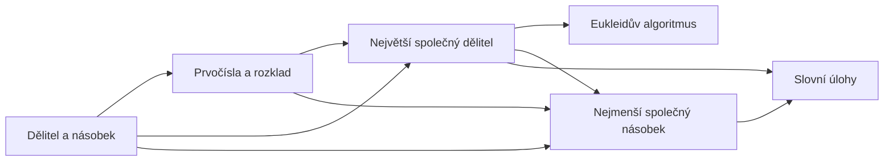

# Dělitelnost

Kdy jde jedno přirozené číslo vydělit druhým beze zbytku — a co z toho plyne.
Hlavní cíl: umět spočítat **největší společný dělitel** a **nejmenší společný násobek** a poznat, kdy který použít.
{ .lead }

## Mapa pojmů

## Doporučené pořadí

1. [Dělitel a násobek](delitel-a-nasobek.md) — $a \mid b$, kritéria dělitelnosti
2. [Prvočísla a rozklad](prvocisla.md) — stavební kameny všech čísel
3. [Největší společný dělitel](nsd.md) — $D(a, b)$, krácení zlomků
4. [Nejmenší společný násobek](nsn.md) — $n(a, b)$, společný jmenovatel
5. [Eukleidův algoritmus](eukleiduv-algoritmus.md) — rychlé NSD i pro velká čísla
6. [Slovní úlohy](slovni-ulohy.md) — kdy NSD, kdy nsn, řešené příklady

!!! tip "NSD a nsn v jedné větě"
    **NSD** = největší kus, kterým jde *beze zbytku rozdělit* obě čísla.
    **nsn** = nejmenší číslo, *do kterého se obě vejdou* beze zbytku.
    NSD je menší nebo rovný oběma číslům, nsn je větší nebo rovný oběma.

Souvislost s [množinami](../mnoziny/index.md): společní dělitelé jsou [průnik](../mnoziny/prunik.md) množin dělitelů,
společné násobky průnik množin násobků.
