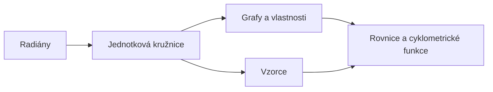

# Goniometrické funkce

$\sin$, $\cos$, $\operatorname{tg}$ a $\operatorname{cotg}$ převádějí **úhel na číslo**. Popisují všechno, co se otáčí nebo
kmitá: kruhový pohyb, vlnění, střídavý proud, zvuk.
{ .lead }

## Mapa pojmů

## Doporučené pořadí

1. [Radiány](radiany.md) — jiná jednotka úhlu, $180° = \pi$
2. [Jednotková kružnice](jednotkova-kruznice.md) — definice $\sin$, $\cos$, $\operatorname{tg}$, tabulka hodnot
3. [Grafy a vlastnosti](grafy.md) — perioda, sudost, posuny a natažení
4. [Vzorce](vzorce.md) — $\sin^2 x + \cos^2 x = 1$, součtové vzorce, dvojnásobný úhel
5. [Rovnice a cyklometrické funkce](rovnice.md) — $\sin x = \frac12$, $\arcsin$

!!! tip "Nejdůležitější obrázek"
    Bod na kružnici o poloměru $1$, otočený o úhel $\alpha$, má souřadnice $[\cos\alpha;\ \sin\alpha]$.
    Všechno ostatní z toho plyne. Vyzkoušej na stránce [Jednotková kružnice](jednotkova-kruznice.md).

Derivace a integrály goniometrických funkcí: [Tabulka derivací a integrálů](../analyza/tabulky.md).
