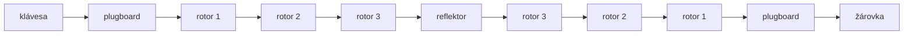

# Enigma

Elektromechanický šifrovací stroj, který používalo Německo za 2. světové války.
Je to **polyalfabetická** substituce: po každém stisku klávesy se rotory pootočí,
takže stejné písmeno se pokaždé zašifruje jinak.
{ .lead }

| Část | Funkce |
|---|---|
| **3 rotory** | permutace abecedy; po každém písmenu se otočí, takže se mění šifra |
| **Reflektor** | jako rotor, ale neotáčí se; pošle signál zpět. Díky tomu **stejné nastavení šifruje i dešifruje** |
| **Plugboard** | počáteční záměna dvojic písmen, během šifrování se nemění |
| **Klíč** | tři písmena = počáteční natočení rotorů |

Důsledek reflektoru: **žádné písmeno se nezašifruje samo na sebe**. Právě to (a opakující se fráze ve zprávách)
pomohlo Enigmu prolomit polským a britským kryptologům.

Princip „každé písmeno jiným posunem" má i [Vigenèrova šifra](vigenerova-sifra.md), jen tam se posuny opakují s periodou klíče.
