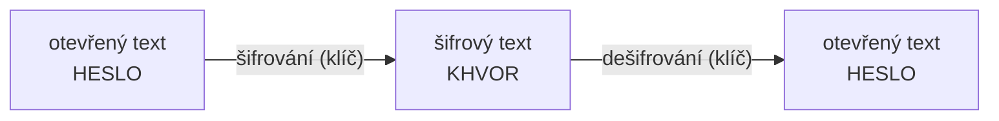

# Kryptografie

Věda o utajování zpráv. **Šifrování** změní čitelný *otevřený text* na nečitelný *šifrový text* (kryptogram)
pomocí **klíče**. Kdo klíč zná, umí zprávu **dešifrovat**. Moderní kryptografie stojí na
[modulární aritmetice](modularni-aritmetika.md) a [prvočíslech](../delitelnost/prvocisla.md).
{ .lead }

## Klasické a moderní šifry

| | Klasické šifry | Moderní šifry |
|---|---|---|
| Počítá se | ručně | počítačem |
| Princip | **substituce** (písmeno → jiné písmeno) nebo **transpozice** (přeházení pořadí) | složitá matematika (prvočísla, modulo, …) |
| Bezpečnost | nízká, prolomí je [frekvenční analýza](frekvencni-analyza.md) | vysoká, odolné známým útokům |
| Příklady | [Atbash](atbash.md), [Caesar](caesarova-sifra.md), [Vigenère](vigenerova-sifra.md), [Skytale](skytale.md) | AES, [RSA](rsa.md), [Diffie-Hellman](diffie-hellman.md) |

Moderní šifry se dělí na [symetrické a asymetrické](symetricka-a-asymetricka.md).

## Mapa sekce

-   :material-script-text-outline: **Klasické šifry**

    ---

    [Atbash](atbash.md) · [Skytale](skytale.md) · [Caesarova šifra](caesarova-sifra.md) ·
    [Vigenèrova šifra](vigenerova-sifra.md) · [Vernamova šifra](vernamova-sifra.md) ·
    [Frekvenční analýza](frekvencni-analyza.md) · [Enigma](enigma.md)

-   :material-calculator-variant-outline: **Teorie čísel**

    ---

    [Modulární aritmetika](modularni-aritmetika.md) · [Kongruence](kongruence.md) ·
    [Algebraické struktury](algebraicke-struktury.md) · [Eulerova funkce](eulerova-funkce.md) ·
    [Modulární mocnění](modularni-mocneni.md) · [Inverzní prvek](inverzni-prvek.md) ·
    [Rozšířený Eukleidův algoritmus](rozsireny-eukleiduv-algoritmus.md) ·
    [Malá Fermatova a Eulerova věta](fermatova-a-eulerova-veta.md) ·
    [Čínská věta o zbytcích](cinska-veta-o-zbytcich.md) · [Generátory grupy](generatory.md)

-   :material-numeric: **Prvočísla**

    ---

    [Testy prvočíselnosti](testy-prvociselnosti.md): [Fermatův](fermatuv-test.md),
    [Miller-Rabinův](miller-rabinuv-test.md), [Lucas-Lehmerův](lucas-lehmeruv-test.md)

-   :material-key-chain: **Asymetrická kryptografie**

    ---

    [RSA](rsa.md) · [Diffie-Hellman](diffie-hellman.md) ·
    [Útok muž uprostřed](utok-muz-uprostred.md) · [DSA podpis](dsa.md)

Všechny úlohy ze cvičení s řešením jsou na stránce [Cvičení](cviceni.md).

## Co je potřeba z matematiky

- [Prvočísla a rozklad na prvočísla](../delitelnost/prvocisla.md) (*kanonický rozklad*): $5864 = 2^3 \cdot 733$
- [Největší společný dělitel](../delitelnost/nsd.md): v kryptografii se značí **GCD** (*Greatest Common Divisor*), česky NSD, $D(a, b)$
- [Nejmenší společný násobek](../delitelnost/nsn.md): **LCM** (*Least Common Multiple*), česky NSN, $n(a, b)$
- [Eukleidův algoritmus](../delitelnost/eukleiduv-algoritmus.md) pro GCD

!!! tip "Nesoudělná čísla"
    Čísla $a, b$ jsou **nesoudělná**, když $\mathrm{GCD}(a, b) = 1$, tedy nemají společného dělitele kromě 1.
    Tahle podmínka se v kryptografii objevuje pořád: u [inverzního prvku](inverzni-prvek.md), [Eulerovy věty](fermatova-a-eulerova-veta.md), [RSA](rsa.md)…
