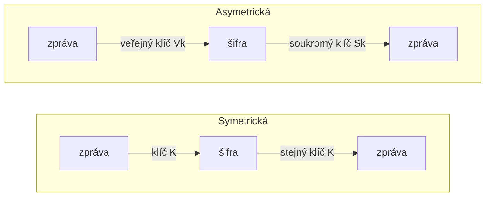

# Symetrické a asymetrické šifry

**Symetrická** šifra má jeden tajný klíč pro šifrování i dešifrování.
**Asymetrická** má dva klíče: *veřejný* (kdokoli jím může šifrovat) a *soukromý* (jen majitel jím dešifruje).
{ .lead }

| | Symetrická | Asymetrická |
|---|---|---|
| Klíče | jeden tajný | soukromý $S_k$ + veřejný $V_k$ |
| Délka klíče | 128, 192, 256 bitů | 2048, 3072, 4096 bitů |
| Rychlost | **rychlá** | pomalá |
| Problém | jak bezpečně předat klíč? | výpočetně náročná |
| Použití | přenos dat | výměna klíčů, podpisy |
| Příklady | AES (bloková), RC4 (proudová) | [RSA](rsa.md), [Diffie-Hellman](diffie-hellman.md), [DSA](dsa.md) |

## Proč obojí

Symetrická šifra je rychlá, ale obě strany musí znát stejný klíč, a ten nejde jen tak poslat po internetu.
Asymetrická tenhle problém řeší, jenže je pomalá. V praxi (např. HTTPS) se proto kombinují:

1. Asymetricky ([Diffie-Hellman](diffie-hellman.md) nebo [RSA](rsa.md)) se ustanoví sdílený tajný klíč.
2. Data se pak šifrují rychle symetricky (AES) tímto klíčem.

!!! warning "Soukromý klíč"
    Soukromý klíč se nikdy nesdílí a musí být bezpečně uložený. Slouží k **dešifrování** a k **podpisu** ([DSA](dsa.md)).
