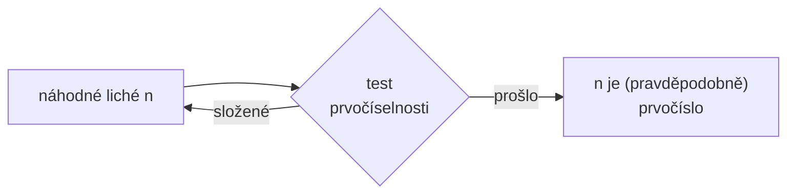

# Testy prvočíselnosti

[RSA](rsa.md) i [Diffie-Hellman](diffie-hellman.md) potřebují **obrovská prvočísla** (stovky číslic).
Generují se tak, že se vezme náhodné liché číslo a **otestuje** se. Když prvočíslo není, zkusí se další.
{ .lead }

## Druhy testů

| Test | Typ | Jak funguje | Rychlost |
|---|---|---|---|
| **Zkusmé dělení** | jistý | vyděl $n$ všemi čísly do $\sqrt{n}$ | nepoužitelné pro velká $n$ |
| [**Fermatův test**](fermatuv-test.md) | pravděpodobnostní | [Malá Fermatova věta](fermatova-a-eulerova-veta.md): $a^{n-1} \equiv 1$ | rychlý |
| [**Miller-Rabinův test**](miller-rabinuv-test.md) | pravděpodobnostní | zesílený Fermat, nenechá projít Carmichaelova čísla | rychlý, **používá se v praxi** |
| [**Lucas-Lehmerův test**](lucas-lehmeruv-test.md) | jistý | jen pro Mersennova čísla $2^s - 1$ | rychlý, ale speciální |
| AKS (Agrawal–Kayal–Saxena) | jistý | obecný, polynomiální čas | v praxi pomalý |

!!! definice "Pravděpodobnostní test"
    Když test řekne **„složené"**, je to **jisté**. Když řekne **„prošlo"**, je číslo jen *pravděpodobně* prvočíslo.
    Test projde i některé složené číslo. Proto se opakuje s různými náhodnými základy $a$. Každé opakování
    pravděpodobnost chyby zmenší (u Miller-Rabina aspoň čtyřikrát).

Pro malá čísla stačí [Eratosthenovo síto](../delitelnost/prvocisla.md) nebo zkusmé dělení. Všechny testy tady používají
[modulární mocnění](modularni-mocneni.md) (Square and Multiply).
