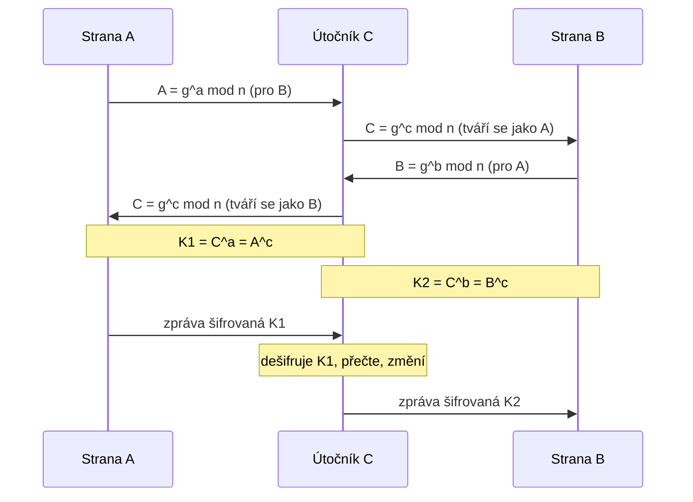

# Útok muž uprostřed

*Man-in-the-Middle* (MitM). Útočník C stojí mezi stranami A a B a s **každou zvlášť** ustanoví klíč
[Diffie-Hellmanem](diffie-hellman.md). Obě strany si myslí, že mluví spolu, ale ve skutečnosti mluví s útočníkem.
Ten všechno čte, a když chce, i mění.
{ .lead }

!!! example "Příklad ze cvičení"
    Veřejné: $n = 23$, $g = 6$, $q = 11$. Tajné: $a = 3$, $b = 5$, $c = 4$.

    | Strana A | Útočník C | Strana B |
    |---|---|---|
    | $A = 6^3 \bmod 23 = 9$ → | přijme $A = 9$ | |
    | | přijme $B = 2$ | ← $B = 6^5 \bmod 23 = 2$ |
    | přijme $C = 8$ | ← $C = 6^4 \bmod 23 = 8$ → | přijme $C = 8$ |
    | $K_1 = C^a = 8^3 \bmod 23 = 6$ | $K_1 = A^c = 9^4 \bmod 23 = 6$   $K_2 = B^c = 2^4 \bmod 23 = 16$ | $K_2 = C^b = 8^5 \bmod 23 = 16$ |

## Jak útok probíhá

1. Strana A zašifruje zprávu klíčem $K_1$ a pošle ji „straně B".
2. Útočník ji zachytí a dešifruje klíčem $K_1$, který zná.
3. Přečte ji, případně upraví, a zašifruje klíčem $K_2$.
4. Pošle ji straně B, která ji klíčem $K_2$ v pořádku dešifruje a nic nepozná.

## Obrana

Chybí **autentizace**: kdokoli se může vydávat za kohokoli. Řešení je **podepsat** DH parametry,
např. certifikátem nebo [digitálním podpisem](dsa.md). Útočník pak nemůže podvrhnout své $C$, protože nezná soukromý klíč strany.

??? question "Cvičení: $n = 23$, $g = 6$; $a = 6$, $b = 9$, $c = 7$"
    $A = 6^6 \bmod 23 = 12$, $\ B = 6^9 \bmod 23 = 16$, $\ C = 6^7 \bmod 23 = 3$

    - $K_1$ (A ↔ C): $C^a = 3^6 \bmod 23 = \mathbf{16}$ $\ = A^c = 12^7 \bmod 23 = 16$ ✓
    - $K_2$ (C ↔ B): $C^b = 3^9 \bmod 23 = \mathbf{18}$ $\ = B^c = 16^7 \bmod 23 = 18$ ✓
