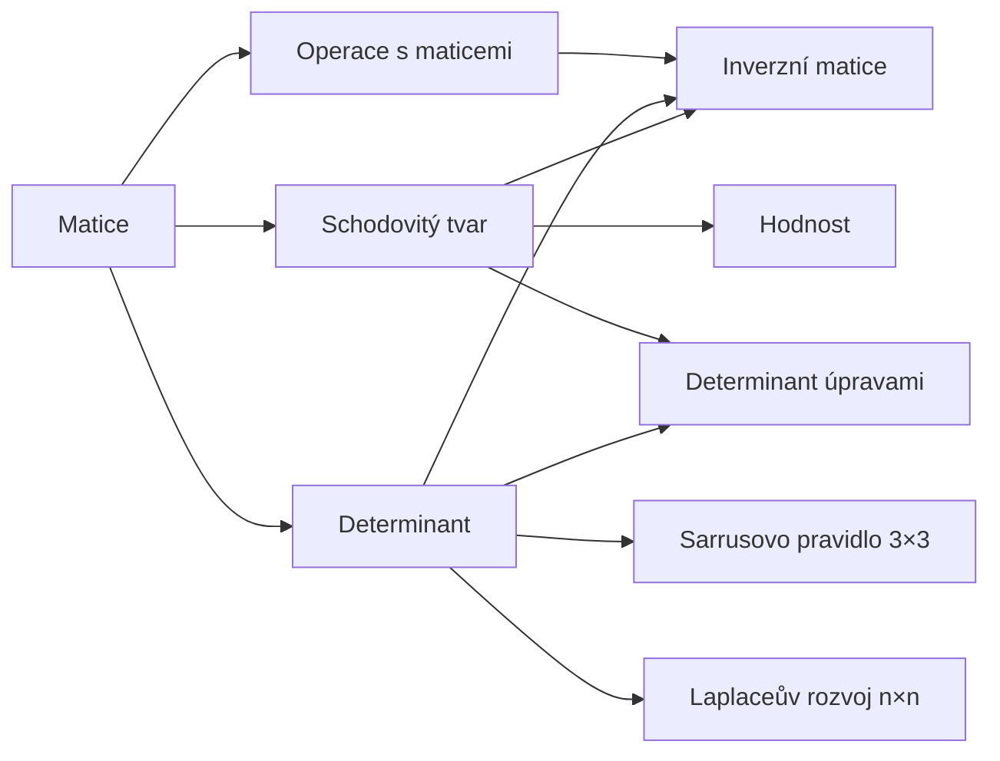

# Matice

Matice je obdélníková tabulka čísel. Umí zapsat soustavu rovnic, geometrickou transformaci nebo data —
a dá se s ní počítat skoro jako s čísly.
{ .lead }

## Mapa pojmů

## Doporučené pořadí

1. [Matice](matice.md) — co to je, typy matic, transpozice
2. [Operace s maticemi](operace.md) — sčítání, násobení
3. [Schodovitý tvar](schodovity-tvar.md) — Gaussova eliminace, hodnost
4. [Determinant](determinant.md) — co znamená, $2 \times 2$, vlastnosti
5. [Sarrusovo pravidlo](sarrusovo-pravidlo.md) — rychlý determinant $3 \times 3$
6. [Laplaceův rozvoj](laplaceuv-rozvoj.md) — determinant $4 \times 4$ a větší
7. [Determinant úpravami](determinant-upravami.md) — nejrychlejší cesta pro $4 \times 4$
8. [Inverzní matice](inverzni-matice.md) — $A^{-1}$ Gaussovou–Jordanovou metodou i vzorcem

!!! tip "Jak spočítat determinant – rozcestník"
    | Velikost | Doporučená metoda |
    |---|---|
    | $2 \times 2$ | vzorec $ad - bc$ ([Determinant](determinant.md#determinant-2-2)) |
    | $3 \times 3$ | [Sarrusovo pravidlo](sarrusovo-pravidlo.md) |
    | $4 \times 4$ | vyrobit nuly [úpravami](determinant-upravami.md), pak [Laplace](laplaceuv-rozvoj.md) → $3 \times 3$ → Sarrus |
    | větší | [úpravy na trojúhelníkový tvar](determinant-upravami.md) |
