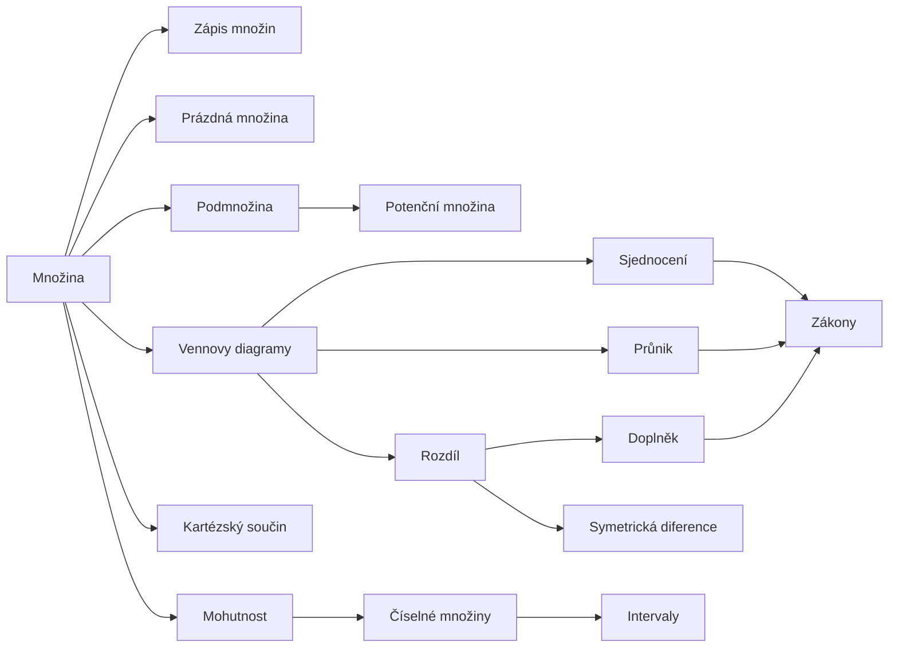

# Množiny

Množiny jsou základní stavební kámen matematiky: čísla, funkce, relace, geometrické
útvary — to všechno se dá popsat jako množiny. Stačí k tomu jediný pojem: *„být prvkem"*.
{ .lead }

## Mapa pojmů

## Doporučené pořadí

**Základy**

1. [Množina](mnozina.md) — co to je, prvek, $\in$
2. [Zápis množin](zapis-mnozin.md) — výčtem, vlastností
3. [Prázdná množina](prazdna-mnozina.md) — $\emptyset$
4. [Podmnožina a rovnost](podmnozina.md) — $\subseteq$, $=$
5. [Potenční množina](potencni-mnozina.md) — množina všech podmnožin

**Operace**

6. [Vennovy diagramy](vennovy-diagramy.md) — jak množiny kreslit
7. [Sjednocení](sjednoceni.md) $\cup$ · [Průnik](prunik.md) $\cap$ · [Rozdíl](rozdil.md) $\setminus$ · [Doplněk](doplnek.md) $A'$ · [Symetrická diference](symetricka-diference.md) $\Delta$
8. [Zákony množinových operací](zakony.md) — De Morgan a spol.

**Dál**

9. [Kartézský součin](kartezsky-soucin.md) — dvojice, $A \times B$
10. [Mohutnost](mohutnost.md) — kolik má množina prvků (i nekonečně)
11. [Číselné množiny](ciselne-mnoziny.md) — $\mathbb{N} \subset \mathbb{Z} \subset \mathbb{Q} \subset \mathbb{R} \subset \mathbb{C}$
12. [Intervaly](intervaly.md) — souvislé kusy reálné osy

!!! tip "Hřiště"
    Na stránce [Kalkulačka množin](kalkulacka.md) si můžeš zadat vlastní množiny a sledovat,
    co s nimi dělají jednotlivé operace.
